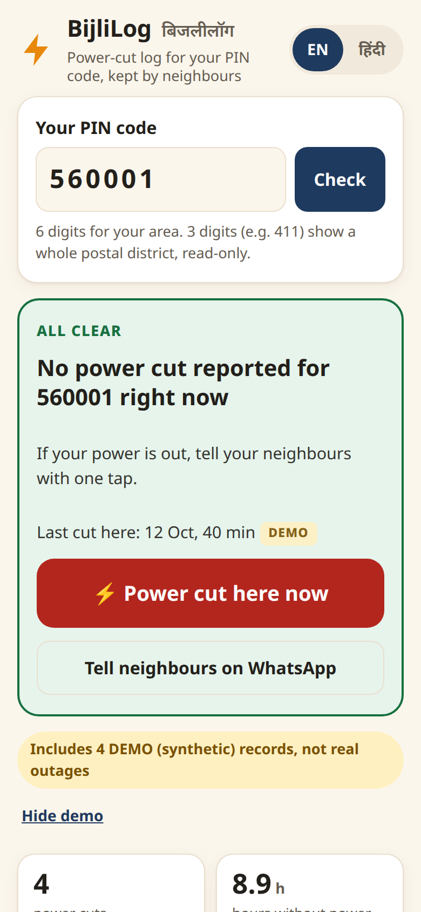
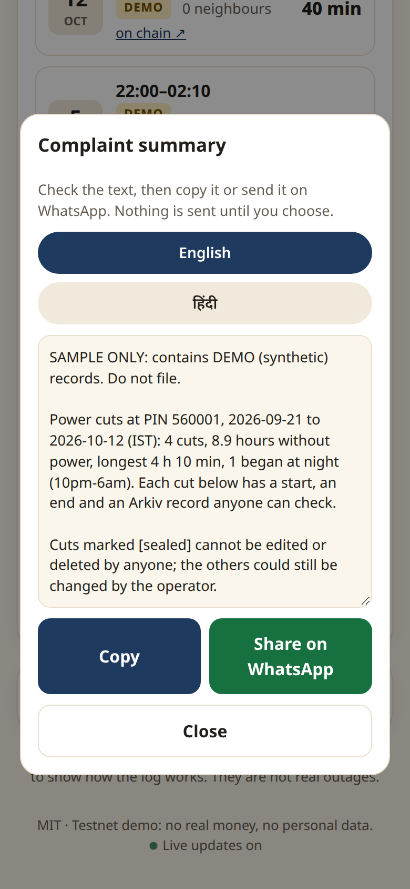

# BijliLog

**A community-kept power-cut log for your PIN code, stored on [Arkiv](https://arkiv.network).** Built for the Arkiv Global Tour Stop, tracks *Best Indian Use Case*, *Security* and *Censorship Resistance*. Runs on the Arkiv **Tiramisu testnet** (chain 7738577): no real money, no personal data.

> **Live app:** <https://bijlilog-196979752200.us-central1.run.app> · **Demo video:** linked on the Devfolio submission · Contract: [`arkiv/schema.md`](arkiv/schema.md) · Friction report: [`arkiv/friction.md`](arkiv/friction.md)

<p align="center"> </p>
<p align="center"><sub>Phone view (DEMO data). Right: the complaint summary; with DEMO records it says "SAMPLE ONLY. Do not file."</sub></p>

## Why India
Power cuts are an everyday fact for households and small shops across India, and the record of *when* power went and *how long* it stayed off normally sits with the utility. A tenant, a shopkeeper or a residents' association that wants to complain about repeated evening or night cuts has to rely on memory. BijliLog gives a neighbourhood a shared, tamper-evident log keyed on the one identifier everybody knows, the 6-digit **PIN code**, in English and Hindi, on a phone, without an account:

- **Report** a cut in one tap; neighbours tap **Still dark** to confirm and keep it live.
- **History** per PIN (or postal district by prefix): cuts, hours without power, longest cut, how many began at night, filtered by "confirmed by a neighbour" and "4 hours or more".
- **Get a ready-to-send complaint summary** (English or Hindi, copy or WhatsApp), citing the Electricity (Rights of Consumers) Rules 2020 and the 45-day forum period; if any record is DEMO it is marked "SAMPLE ONLY, do not file". **Or download a CSV**: PIN, start, end and duration of each cut, how many neighbours confirmed it, and an Arkiv entity key with an explorer link, so whoever receives it can verify it independently. A resident can attach it to a complaint to the discom or the Consumer Grievance Redressal Forum set up under the 2020 Rules (which must resolve a grievance within 45 days).

**Public sources behind the problem** (cited, not ours):
- The [Electricity (Rights of Consumers) Rules, 2020](https://www.cag.org.in/blogs/electricity-rights-consumers-rules-2020) require distribution licensees to supply 24x7 power (Rule 10), to communicate scheduled outages by SMS or other electronic means (Rule 16), and provide for automatic compensation (Rule 13). Unscheduled cuts have no neighbour-held record: that gap is what BijliLog fills. (PIB press release on the Rules: <https://www.pib.gov.in/PressReleasePage.aspx?PRID=1682384>.)
- State compensation schemes pay for *restoration delay*, which needs a start and an end time. Example from the same source: Tamil Nadu pays Rs 50 for every six hours (or part) of delay in restoration, capped at Rs 2,000. A BijliLog cut record is exactly a start, an end and a verifiable key.
- A [LocalCircles survey of 23 May 2024](https://www.localcircles.com/a/press/page/electricity-power-outage-survey) (over 15,000 households in 364 districts; self-selected online respondents, so indicative only) reported that 38% of households confirmed daily power outages, up from 20% in February. We quote it as context, not as a measurement of any PIN code.

*Honesty note:* this was built and tested by one person. It has no real users yet, and the demo records are synthetic and labelled **DEMO** in the app. We make no claims about outage statistics. Four cut records written by our own test runs on 17 Oct (keys in `TEST_RUN_KEYS`, `src/lib/schema.js`) are stored on chain as `source=user`, because the relay then did not yet pass `demo` through; they are synthetic, and the app and `verify.mjs` label them DEMO. Since then, acting on a DEMO outage always writes DEMO records. One live test report (0xc85a…6972) from the same run expired on 17 Oct without being closed.

## Why Arkiv (what breaks without it)
| Property used | What goes wrong on a database an operator controls |
|---|---|
| **Entities expire by themselves** | A "live cut" must disappear if nobody confirms it. Here the 2-hour lease *is* the entity's expiration; no cleanup job to trust or run. |
| **Permissionless extension** | Any neighbour renews a lease without being its owner and without being able to edit it. A database needs accounts and an auth model for that. |
| **Read-only + sealed entities** | When power returns, the cut record is created `readonly` and handed to the burn address `0x…dEaD` in the same transaction. Verified on Tiramisu (`evidence/e2e-output.txt`): the relay's own patch and delete are both rejected ("owned by 0x…dEaD"), and anyone can still extend it. Nobody, including us, can edit or delete a sealed cut (every cut closed or added through the app; the early DEMO seed records are not sealed). That is what makes it usable evidence in a complaint. |
| **Creator is on-chain (`$creator`)** | Readers filter on the relay wallet, so strangers cannot inject look-alike records. |
| **What we still control (honest limit)** | New reports go through our relay, which pays the testnet fee. If it is down or blocked, nobody can add a cut through this site, but no sealed cut record can be changed or removed (every cut closed or added through the app is sealed; the early DEMO seed records and live reports are not), and anyone with test GLM can write the same entity shape with their own wallet (readers would need to add that wallet to `RELAYS`). |
| **Queries from the browser** | The page reads Arkiv directly. If our server disappears, every record stays readable and queryable. |

## Why Security and Censorship Resistance
**Who is misled today:** a resident who sends a list of power cuts to a discom or to the Consumer Grievance Redressal Forum can be told the list is made up, and an operator-run app could quietly edit or drop entries. **What changes from day one:** a cut is shown only if its on-chain `$creator` is the BijliLog relay (`createdBy(relay)` in every query, so a look-alike entity written by a stranger is ignored), and each live row's "signed ✓" badge re-verifies the phone's signature from Arkiv data alone. Finished cuts are sealed to a burn address, so even the operator cannot rewrite history. **Without our backend:** `node scripts/verify.mjs 411` reads the same records straight from the public Tiramisu RPC; if this site is blocked or our server disappears, the log stays readable and queryable.

What deliberately stays off Arkiv: device private keys, the relay wallet key and rate-limit counters.

## How it uses Arkiv
Details and exact queries are in [`arkiv/schema.md`](arkiv/schema.md). In short: typed attributes with numeric ranges (`started_at_ms`, `duration_min`, `confirmers`), `startsWith` on `pin` for postal districts, `$creator` filtering, cursor pagination, **different expiry per type** (outage 2 h, confirm 30 d, cut log 365 d), `extendEntity` as a lease renewed by activity, creation flags (`permissionlessExtension`, `readonly`), **atomic batches** (confirm + renew; cut record + end of lease) and `watchEntityEvents` over WebSocket so the page updates without polling.

**Trust model.** One relay wallet pays the testnet fee, so neighbours need no wallet. Each phone holds a device key that only signs; the signed text sits in the entity payload with the signer's address, and the app re-verifies the signature on every record it shows.

## Run it
Needs Node 22.
```bash
npm ci
npm test                       # 20 tests (data contract, validation, relay logic, server routing)
npm run build && npm start     # http://localhost:8080 : read-only until a relay key is set
```
To enable writes, put a **testnet-only** key in `.env.local` as `SPONSOR_PRIVATE_KEY=0x...`, fund its address with test GLM at <https://hub.arkiv.network/faucet>, then `npm run dev`.
```bash
node --env-file=.env.local scripts/seed.mjs --live   # synthetic, labelled demo data (add --dry to preview)
node scripts/seed-demo-pin.mjs 380001 --live-cuts # sealed synthetic "Synthetic demo" history + 3 live-style cuts on one PIN (the PIN shown in the demo video)
node scripts/e2e.mjs                                  # real create/extend/batch run against Tiramisu (relay must be funded)
node scripts/verify.mjs 411                           # any live cut (2-hour leases) and the full history, read straight from Arkiv
CONFIRM_PUBLIC=1 scripts/deploy-cloudrun.sh           # optional: Cloud Run (Dockerfile included)
```
The relay wallet address that creates every entity is in [`src/web/config.js`](src/web/config.js).

## Layout
`src/lib/` data contract, validation, signing, stats · `server/` write relay and static server · `src/web/`, `web/` browser app · `arkiv/` schema and friction report · `scripts/` seed, verify, probes, video pipeline · `test/` tests.

## AI assistance
Built with AI assistance (Claude Code, Anthropic): the code was written by Claude Code under the author's direction, and the tests are in this repo. **Narration: AI copy of my own voice (consented).** The demo video is narrated by an AI voice clone of the author's own voice, made with the author's consent; it is not a live recording.

## Licence
MIT, see [LICENSE](LICENSE).
